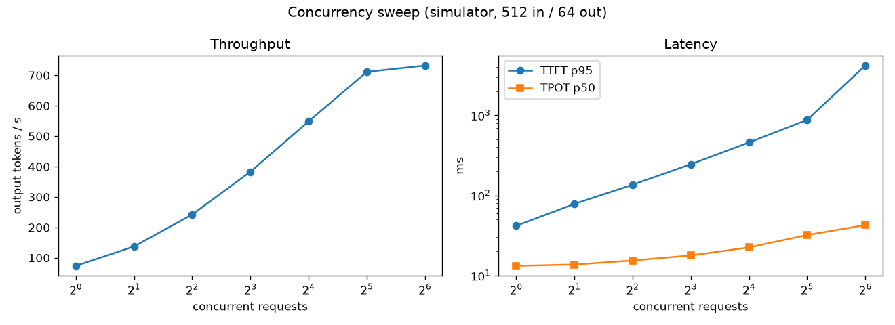

# infer-bench

Load-test an LLM inference server and say **which layer the latency is coming from**.

It drives any OpenAI-compatible streaming endpoint (vLLM, SGLang, NVIDIA NIM), timestamps
every streamed token, and splits latency into the parts that have different causes:

| Metric | What it is | What makes it worse |
|---|---|---|
| **TTFT** (time to first token) | queueing + prefill | waiting for KV memory / a batch slot; long prompts; many prompts prefilled in one step |
| **TPOT** (time per output token) | the decode loop | bigger decode batches; memory bandwidth |
| **ITL p99** (worst gap between tokens) | stalls inside a stream | a new prompt's prefill landing in the same step as running decodes |
| **tokens/s** | throughput | flattens when the server stops admitting more work |

A `diagnose` step reads a concurrency sweep and points at the layer to check next. It's a
heuristic that tells you where to look, not a proof.

## Status: simulator results only

I don't have a GPU on this machine, so it ships with a **toy continuous-batching engine**
(`simserver.py`). It models prefill, batched decode, a KV-cache memory limit, prefix
caching and chunked prefill, and lets each one be switched on and off. **Its timings are
made up, so the numbers below show the mechanisms, not how fast any real hardware is.**
The same client points at a real `vllm serve` without code changes (see below).

## What the simulator shows



**1. Throughput stops scaling because requests can't get in, not because decoding got slow.**
From 32 to 64 concurrent requests, tokens/s rose only 3%, TTFT p95 grew **4.8x**
(875 ms to 4.2 s) and TPOT grew 1.3x. Each request reserves KV memory for prompt + output
(576 tokens), so a 24,576-token cache fits about 42 sequences. Everything after that
waits in the queue. Faster kernels wouldn't help: what would help is more KV memory
(quantised KV cache, a smaller model, a bigger GPU) or shorter max lengths.

*The diagnosis code got this wrong at first.* It saw TPOT rising and blamed GPU
saturation. I fixed the rule so that a TTFT jump much larger than the TPOT jump reads as
queueing, and added that exact case as a regression test.

**2. Prefix caching: a shared system prompt doesn't have to be prefilled again.**
1024-token prompts, 960 tokens shared, 16 concurrent: TTFT p50 **849 ms to 95 ms**, and
throughput **+45%**. TPOT didn't change, which is expected: caching saves prefill work,
not decode work.

**3. Chunked prefill trades TTFT for smooth streaming.**
2048-token prompts arriving at 4 req/s. Without chunking, a new prompt's whole prefill
lands in one step and every running stream stalls: ITL p99 is **123 ms against a p50 of
19 ms**. Capping prefill at 256 tokens per step cuts ITL p99 to **35 ms**, but TTFT p50
doubles (593 ms to 1.2 s) because each prompt is spread over more steps. Which one is
"better" depends on the product: chat users notice stutter, batch jobs only care about
total time.

Full tables: [`results/SIM_RESULTS.md`](results/SIM_RESULTS.md).

**Limits.** Every result is from a single run. Between two runs, ITL p99 at concurrency 4
moved from 16 ms to 66 ms, which is noise from the Python event loop and the OS
scheduler, not the engine. A real report needs repeated runs and a spread, not one
number. The simulator reserves KV for the full output up front (vLLM allocates in pages
and can preempt instead), never evicts its prefix cache, and counts one word as one token.

## Run it

```bash
uv sync
uv run pytest                                   # 15 tests: scheduler, metrics, HTTP round trip
uv run python scripts/run_sim_experiments.py    # regenerates results/
```

Against the simulator by hand:

```bash
uv run infer-bench serve-sim --port 8000 --prefix-caching
uv run infer-bench sweep --base-url http://127.0.0.1:8000 --concurrency 1,4,16,64 --out results/run.json --plot
```

### Against a real GPU (next step, not done yet)

On a rented GPU (any single card that runs vLLM):

```bash
pip install vllm
vllm serve Qwen/Qwen2.5-1.5B-Instruct --max-model-len 4096
uv run infer-bench sweep --base-url http://localhost:8000 --model Qwen/Qwen2.5-1.5B-Instruct \
    --concurrency 1,2,4,8,16,32,64,128 --out results/gpu/sweep.json --plot
```

Then repeat experiments 2 and 3 using vLLM's own switches (prefix caching on/off, the
per-step token budget that controls chunked prefill; check `vllm serve --help` for your
version's flag names). Before trusting my client, run vLLM's built-in serving benchmark
on the same workload and check the two agree on TTFT and TPOT.

## Layout

```
src/infer_bench/
  client.py     streaming request, per-token timestamps, TTFT/TPOT/ITL
  workload.py   synthetic prompts (with optional shared prefix), closed-loop or Poisson load
  metrics.py    percentiles and the per-level summary row
  report.py     markdown table, chart, diagnose()
  simserver.py  toy engine + /v1/completions SSE endpoint
  cli.py        `sweep` and `serve-sim`
scripts/run_sim_experiments.py   the three experiments above
```
